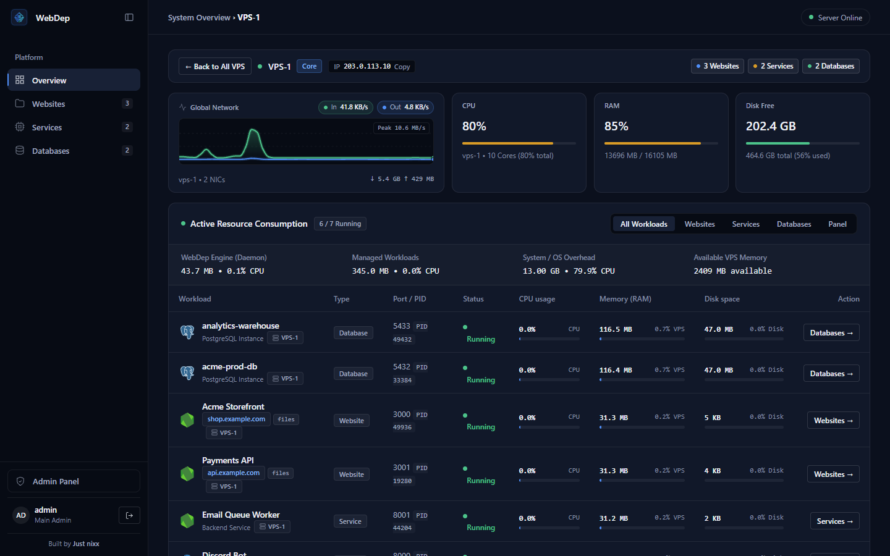
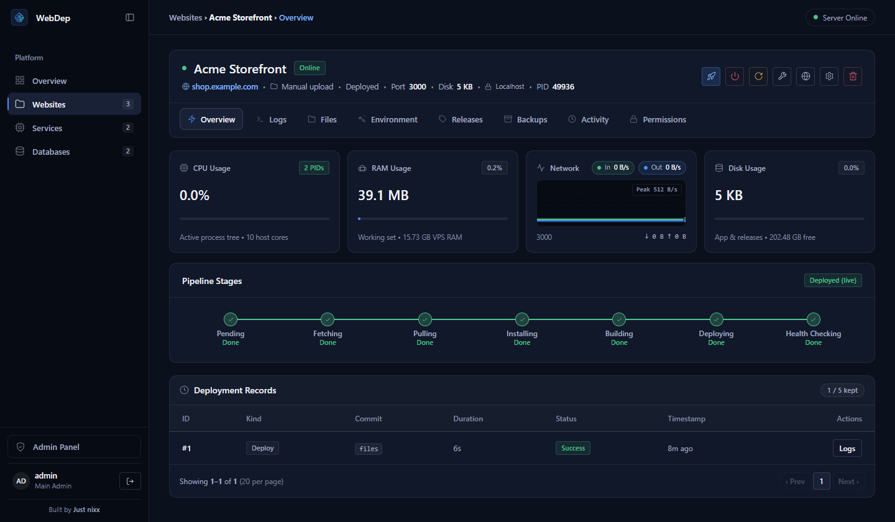
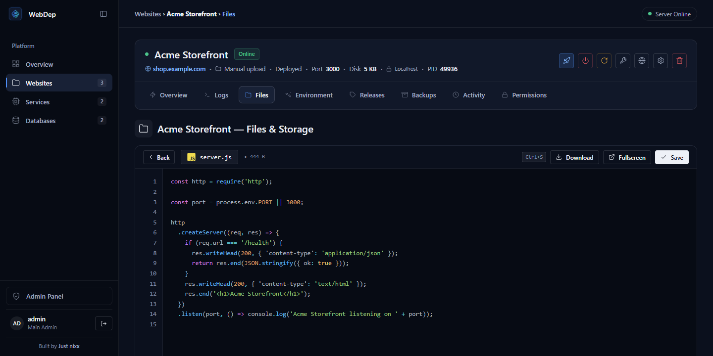
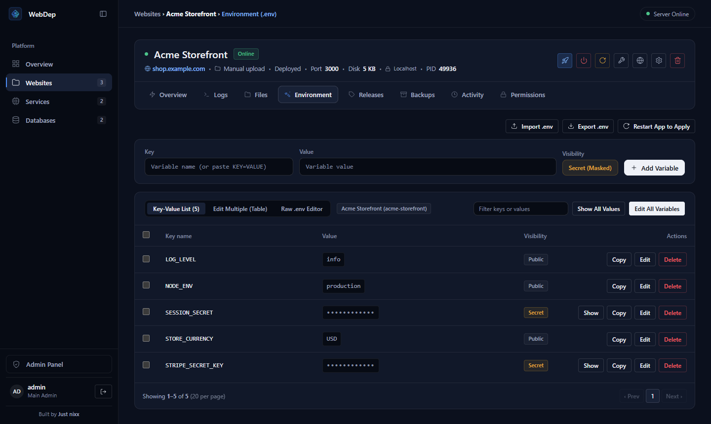
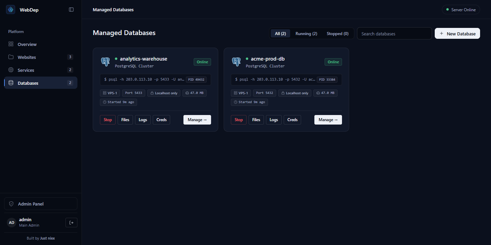

<div align="center">



<br>

Deploy websites, backend services and PostgreSQL databases across one VPS or many, from a single Rust binary.

[](https://github.com/ded-lmfao/WebDep/releases/latest)
[](https://github.com/ded-lmfao/WebDep/actions/workflows/release.yml)
[](LICENSE)


[**Quick start**](#-quick-start) ·
[**Features**](#-features) ·
[**Multi-VPS**](#%EF%B8%8F-multi-vps-setup) ·
[**Configuration**](#%EF%B8%8F-configuration) ·
[**Guide**](docs/GUIDE.md) ·
[**Upgrading**](docs/UPGRADING.md)

<br>



</div>

---

## 🚀 Quick start

SSH into a Linux server and paste **one line**. It installs git and curl, downloads WebDep into `/opt/webdep`, sets up a 24/7 system service and opens the firewall ports.

```bash
curl -fsSL https://raw.githubusercontent.com/ded-lmfao/WebDep/main/install.sh | sudo bash -s -- both
```

Then:

1. Open `http://YOUR_SERVER_IP:4600`.
2. Sign in with `ADMIN_USERNAME` and `ADMIN_PASSWORD` from `/opt/webdep/.env`. The first password is also logged once: `sudo journalctl -u webdep-core | grep -i password`.
3. Change the password and turn on two-factor authentication in **My Account**.

> [!IMPORTANT]
> A new panel serves plain HTTP. For your first sign-in, use an SSH tunnel from your own computer, `ssh -N -L 4600:127.0.0.1:4600 root@YOUR_SERVER_IP`, and open `http://localhost:4600`. Set up a domain with HTTPS for everyday use.

> [!WARNING]
> **Running v3.0.12 or older? Do not update it in place.** The database layout changed and the panel will not start afterwards. Install fresh instead. See [Upgrading](#-upgrading-and-backups).

<details>
<summary><b>Other install options</b>: dashboard only, extra server, interactive menu, Windows, manual</summary>

<br>

**Core: dashboard only, hosts no apps**

```bash
curl -fsSL https://raw.githubusercontent.com/ded-lmfao/WebDep/main/install.sh | sudo bash -s -- core
```

**Node: an extra server joining your dashboard.** Copy the ready-made line from **Admin Panel › Nodes › + Add Node**.

```bash
curl -fsSL https://raw.githubusercontent.com/ded-lmfao/WebDep/main/install.sh | sudo bash -s -- node --join http://<VPS1_IP>:4600 --token <WDJOIN_TOKEN>
```

**Interactive menu** (Both, Core, Node, Update, Status, Uninstall)

```bash
curl -fsSL https://raw.githubusercontent.com/ded-lmfao/WebDep/main/install.sh | sudo bash
```

**Windows (PowerShell, no admin needed).** Same menu. Installs to `%LOCALAPPDATA%\WebDep` and starts at logon.

```powershell
irm https://raw.githubusercontent.com/ded-lmfao/WebDep/main/install.ps1 | iex
```

Without the menu:

```powershell
& ([scriptblock]::Create((irm https://raw.githubusercontent.com/ded-lmfao/WebDep/main/install.ps1))) both
```

Replace `both` with `core`, or with `node -Join http://<VPS1_IP>:4600 -Token <TOKEN>`. If no Windows download is available, the installer adds Rust and the Visual C++ Build Tools and compiles (10 to 20 minutes, first time only). `both` and `core` also need PostgreSQL, installed through `winget` if missing.

**Manual, from a checkout (Linux)**

```bash
git clone https://github.com/ded-lmfao/WebDep.git webdep
cd webdep
sudo ./start.sh --service
```

| Installer option | Meaning |
| :--- | :--- |
| `--dir /path` | Install somewhere other than `/opt/webdep` |
| `--branch <name>` | Install a different Git branch (default `main`) |
| `--name`, `--region`, `--public-ip` | Node display name, region label, public IP |
| `--uninstall` | Stop and remove the services. Your files stay in the install folder |

</details>

---

## ✨ Features

<table>
<tr>
<td width="50%" valign="top">

### 🌐 Deploy anything
- Websites and backend services
- Git pipeline with 7 live stages and health checks
- Keeps the newest 5 releases, with rollback
- Automatic HTTPS through Caddy, plus maintenance mode

</td>
<td width="50%" valign="top">

### 🖥️ One panel, many servers
- Add a VPS with one copied command
- WireGuard mesh between servers
- Move apps between servers, rolled back on failure
- Update the whole fleet from the panel

</td>
</tr>
<tr>
<td width="50%" valign="top">

### 🐘 Managed PostgreSQL
- Isolated native database clusters on any server
- SCRAM-SHA-256 sign-in and network access rules
- One-click `DATABASE_URL` linking
- Backups without downtime

</td>
<td width="50%" valign="top">

### 🔐 Secure by design
- Passkeys, TOTP two-factor authentication, sessions
- Per-app permissions and a full audit log
- AES-256-GCM vault; secrets stay masked until you reveal them, and each reveal is recorded
- Linux process isolation for apps and builds

</td>
</tr>
<tr>
<td width="50%" valign="top">

### 📂 Work in the browser
- Live logs and build output
- File explorer with a syntax-highlighted editor
- Environment editor: single, multiple or raw `.env`
- Works on phones and tablets

</td>
<td width="50%" valign="top">

### 📊 Stay in control
- Live CPU, memory, disk and network usage
- CPU, memory, disk and backup limits per app
- Port ranges and multiple public IPs per server
- Webhook alerts to Discord, Slack or any JSON endpoint

</td>
</tr>
</table>

<div align="center">

| Deployment pipeline | Built-in file editor |
| :---: | :---: |
|  |  |
| **Encrypted environment variables** | **Managed PostgreSQL** |
|  |  |

</div>

### Supported runtimes

| Runtime | Example install | Example start | Good for |
| :--- | :--- | :--- | :--- |
| **Node.js** | `npm ci` / `pnpm install` | `npm start` / `node server.js` | Next.js, Express, Fastify, workers |
| **Python** | `pip install -r requirements.txt` | `python -m uvicorn main:app --port {{PORT}}` | FastAPI, Flask, Django, workers |
| **Go** | `go build -o app .` | `./app` | Gin, Echo, Fiber, daemons |
| **Rust** | `cargo build --release` | `./target/release/server` | Axum, Actix-web |
| **Java** | Pre-built JAR / Gradle | `java -jar Lavalink.jar` | Lavalink, Spring Boot |
| **Static / SPA** | `npm run build` | Static build output | React, Vite, Vue, Svelte, Astro |

> [!TIP]
> The start command must name a file that exists in your project. Python services are pre-filled with `main.py`; change it if your entry file has another name.

---

## 🧭 How it works

One binary, two roles.

| Role | What it does | PostgreSQL | Where it runs |
| :--- | :--- | :---: | :--- |
| **Web-Core** (`--core`) | Dashboard and control plane: users, permissions, projects, secrets, backups, job dispatch | Yes, set up automatically | Your main server only |
| **Web-Node** (`--node`) | Worker: builds and runs apps, configures Caddy, streams logs and files | No | Main server and every extra server |

<p align="center">
  
</p>

**Do I need to run `--node` on the first server?** No. Installing with `both` starts Web-Core and a local Web-Node together, so that server can host apps right away. Use `--join` only on extra servers. Use `core` alone if the first server should host nothing.

---

## 🛰️ Multi-VPS setup

1. **Install the first server** with the [quick start](#-quick-start) line.
2. In the panel, open **Admin Panel › Nodes › + Add Node**.
3. Enter a **name**, **region** and the new server's **public IP**. Pick a **panel URL** that the new server can reach.
4. Click **Generate Join Command** and paste the result on the new server:

```bash
curl -fsSL https://raw.githubusercontent.com/ded-lmfao/WebDep/main/install.sh | sudo bash -s -- \
  --node --join http://<VPS1_IP>:4600 --token <WDJOIN_TOKEN> \
  --name "VPS-2" --region "mumbai-IND" --public-ip "<VPS2_IP>"
```

The new server enrols with a single-use token, installs `webdep-node.service`, joins the WireGuard mesh (`10.200.0.x`) and appears **Online** under **Nodes**.

> [!NOTE]
> If your provider has an external firewall (AWS, Oracle, Hetzner, DigitalOcean and others), open:
> - **VPS 1:** TCP `80`, `443`, `4600`; UDP `51820`; your node transfer port (`WEBDEP_NODE_P2P_PORT`)
> - **VPS 2 and more:** TCP `80`, `443` for public traffic; UDP `51820`; node transfer TCP between servers

<details>
<summary><b>Moving apps between servers</b></summary>

<br>

Use **Move Node** on a website or service, or **Admin Panel › Move Apps** (admins only).

1. **Preflight:** the target allocates a free port and checks it is ready.
2. **Transfer:** the source packs the app into a hardened `.tar.gz` (skipping `node_modules`, `.git` and symlinks, rejecting path traversal) and sends it directly to the target.
3. **Warm start:** the target boots the app with its secrets, repoints linked database settings to the mesh address and health-checks it before traffic switches. A failure rolls the target back and leaves the source untouched.
4. **DNS cutover:** with domains attached, the target serves HTTP first and shows the DNS change to make. It then enables HTTPS and retires the old copy.

A **database** is copied with `pg_dump` and `pg_restore` over the mesh while it keeps running. Its linked app is stopped during the copy and receives the new connection settings. The target needs the **PostgreSQL** module (**VPS Modules**). If anything fails, the database stays where it is.

</details>

<details>
<summary><b>Practise with three processes on one Windows PC</b></summary>

<br>

Build once from the repository folder, and remember where the program is:

```powershell
cargo build --locked
$webdep = "$PWD\target\debug\webdep.exe"
```

**Window 1, Web-Core.** Each process needs its own folder and `.env`.

```powershell
mkdir C:\tmp\webdep-core -Force | Out-Null; cd C:\tmp\webdep-core
Set-Content .env "HOST=127.0.0.1`nPORT=4600`nDATA_DIR=C:\tmp\webdep-core\data"
& $webdep --core
```

The generated admin password is saved in that `.env`. Sign in at `http://127.0.0.1:4600`, then create a join token under **Nodes › + Add Node** using **Use 127.0.0.1 (Local)**.

**Window 2, first worker.** Set `$webdep` again and paste your token:

```powershell
mkdir C:\tmp\webdep-node1 -Force | Out-Null; cd C:\tmp\webdep-node1
Set-Content .env "DATA_DIR=C:\tmp\webdep-node1\data`nPORT=4691"
$env:WEBDEP_NODE_P2P_BIND="127.0.0.1"
& $webdep --node --join http://127.0.0.1:4600 --token "PASTE_TOKEN_HERE" --name "VPS-1" --public-ip 127.0.0.1
```

**Window 3, second worker:** repeat with folder `webdep-node2`, port `4692`, name `VPS-2` and a new token.

To restart an enrolled worker later, run `& $webdep --node` from its folder.

</details>

---

## 🧰 Using the panel

| Sidebar | What you do there |
| :--- | :--- |
| **Overview** | Live usage and every running workload, filtered by server |
| **Websites** | Web apps with ports, domains, HTTPS and maintenance mode |
| **Services** | Always-on backend processes: APIs, workers, Lavalink, Go and Rust binaries |
| **Databases** | PostgreSQL clusters and their access rules |
| **My Account** | Profile, password, passkeys, 2FA, sessions and your app access |
| **Admin Panel** | Users, Requests, Nodes, VPS Modules, IP Addresses, Move Apps, App Configs, Platform Settings, Audit |

Each website and service has these tabs:

| Tab | Contents |
| :--- | :--- |
| **Overview** | Deployment pipeline, address and status |
| **Commits** | Branch and commit history |
| **Logs** | Live output and build logs |
| **Files** | Browse, upload, download and edit, limited to the app's folder |
| **Environment** | Encrypted variables and linked databases |
| **Releases** | The newest five releases, with rollback |
| **Backups** | Create, restore, download, lock and delete |
| **Activity** | Audit trail and moves |
| **Permissions** | Who can use the app, and what they can do |

<details>
<summary><b>Accounts and permissions</b></summary>

<br>

- **Sign-up requests:** people ask for an account on the sign-in page, and it exists only after approval in **Admin Panel › Requests**. Admins can also create accounts with a temporary password. Self-registration can be turned off.
- **Roles:** the **Main Admin** (from `.env`) can make other users **Admin**. Everyone else starts with no access.
- **Per-app permissions:** choose people and exactly what each may do: logs, files, deploy, start and stop, backups, environment, domains, settings, activity, connection details.
- **Creating apps:** *Create websites*, *Create services* and *Create databases* are separate permissions. Creators own what they create, including deleting it.
- **Delegation:** trusted users can manage access, view users, create or edit accounts and approve requests. Nobody can grant a permission they don't hold, and every change is audited.
- **Account security:** restrict request email domains, require 2FA for admins or everyone, issue one-time reset links, and see or end sessions. The sign-up form has a bot check.

</details>

<details>
<summary><b>Ports, IP addresses and limits</b></summary>

<br>

- **Port ranges:** new apps take the lowest free port in the server's range. Ports stay private (reached only by Caddy and the mesh) until made public, and the firewall follows. With no free port, the app is not created and the panel says why.
- **Several IPs per server:** add the public IPs and pick one per website or service. Caddy then serves its domains on that IP only.
- **Resource limits:** CPU, memory, disk and number of backups, set at creation and changed in **App Configs**. Empty or `0` means no limit. CPU and memory use cgroups v2 on Linux (WebDep running as root) and Job Objects on Windows. Limits are checked shortly after an app starts and then every 2 minutes. An app over its disk limit is stopped; one at its CPU or memory limit keeps running but slows down. People who can see the app are told why.

</details>

---

## 💾 Upgrading and backups

**Update from the panel** with **Admin Panel › Nodes › Update Fleet** (workers first, then Web-Core), or over SSH with `./start.sh --update`. Running the install line again also updates, keeping `data/` and `.env`.

> [!WARNING]
> **v3.0.12 and older cannot be updated to later releases.** Copy out anything you need, remove the old install, and install fresh.

WebDep backs up its control database before any upgrade that changes it. [docs/UPGRADING.md](docs/UPGRADING.md) covers rollback.

| What | How it works |
| :--- | :--- |
| **App backups** | All files and environment variables in one archive, with size, file count, creator, status and checksum. You can leave out names such as `cache` or `*.log`. |
| **Restore** | Replaces the app's files (never merges), verifies the checksum, swaps folders with rollback and keeps the replaced files for 24 hours. You confirm by typing the app's name. |
| **Database backups** | PostgreSQL dumps taken while running. Restore happens in one transaction, so a failure changes nothing. Not yet available for databases on other servers. |
| **Control database** | Backed up daily (seven kept) and before upgrades, in `data/backups/control-db/`. |
| **Copy on Web-Core** | Optionally keep a copy of another server's app backup, and restore it onto any healthy server. |

App backups are manual, stay on the server that runs the app, and can be locked against deletion. The audit page searches and exports to CSV; panel history is kept for 365 days and each app keeps its newest 100 entries.

> [!CAUTION]
> Back up `data/master.key` **together with** `data/control-pg/`. Without the key, stored secrets cannot be decrypted. Do not copy these folders while PostgreSQL is running.

---

## 🛡️ App isolation (Linux)

Without isolation, deployed code runs as the same user as the panel and could read its data. Isolation is **on by default** when the panel runs as root with util-linux (`unshare`, `setpriv`, `mount`) installed.

- Each app and build gets its own **PID, mount, IPC and UTS namespaces**.
- The panel's folders are **hidden behind an empty filesystem**; only the app's own folder and a private `/tmp` are visible.
- Apps run as an **unprivileged user** (default uid and gid `65534`) with no way to gain privileges.
- Managed **databases** run in their own mount, IPC and UTS namespaces as the `postgres` user, and see only their own folder.

Install runtimes where that user can run them, not under `/root`. The network stays shared so the reverse proxy can reach apps. **App Configs** shows whether isolation is active. Set `WEBDEP_ISOLATE_APPS=0` to turn it off.

> [!NOTE]
> Isolation has had limited testing on real servers. Try it with a test app first.

---

## ⚙️ Configuration

WebDep reads `.env` from its working folder, or normal environment variables.

<details>
<summary><b>Environment variables</b></summary>

<br>

| Variable | Default | Description |
| :--- | :--- | :--- |
| `HOST` | `0.0.0.0` | Address the panel listens on |
| `PORT` | `4600` | Panel and API port |
| `DATA_DIR` | `./data` | Where WebDep stores everything |
| `DATABASE_URL` | built-in PostgreSQL on `5431` | External database for Web-Core (nodes never read it) |
| `ADMIN_USERNAME` | `admin` | Main admin username |
| `ADMIN_PASSWORD` | generated on first start | Main admin password |
| `ADMIN_RESET_2FA` | `false` | Set `true` temporarily to reset the main admin's 2FA |
| `SESSION_TTL_S` | `604800` | Longest session, in seconds (7 days) |
| `SESSION_IDLE_TIMEOUT_S` | `1800` | Sign out after inactivity (`0` disables) |
| `FORCE_SECURE_COOKIES` | `false` | Always mark cookies `Secure` (automatic behind HTTPS) |
| `PUBLIC_IP` | detected | Override the panel's public IP |
| `WEBDEP_NODE_P2P_BIND` | `0.0.0.0` | Address for the node's transfer receiver |
| `WEBDEP_NODE_P2P_PORT` | `0` (any free port) | Port for the node's transfer receiver |
| `WEBDEP_SKIP_DB_BACKUP` | `false` | Set `1` to skip the pre-upgrade backup, only if you back up yourself |
| `WEBDEP_MANAGE_FIREWALL` | `true` | Set `false` to stop WebDep editing UFW and iptables |
| `WEBDEP_ISOLATE_APPS` | on | Set `0` to turn off [app isolation](#%EF%B8%8F-app-isolation-linux) |
| `WEBDEP_APP_UID` / `WEBDEP_APP_GID` | `65534` | User and group for isolated apps |
| `RUST_LOG` | `webdep=info` | Log level |

</details>

<details>
<summary><b>Command-line flags</b></summary>

<br>

| Flag | Description |
| :--- | :--- |
| *(none)* | Start Web-Core with a paired local Web-Node |
| `--core` | Web-Core only |
| `--node` | Web-Node only |
| `--join <URL>` | Enrol a node (with `--node` and `--token`) |
| `--token <TOKEN>` | Single-use join token |
| `--name <LABEL>` | Node name |
| `--region <REGION>` | Node region |
| `--public-ip <IP>` | Public IP or host name for the node |
| `--wg-port <PORT>` | WireGuard UDP port (default `51820`) |
| `--enroll-only` | Enrol, save the node settings and exit |
| `--pair-local` | Pair the local node without starting the server |
| `--version`, `-V` | Print the version and exit |

</details>

<details>
<summary><b>Where data is stored</b></summary>

<br>

Everything lives under `DATA_DIR`.

| Path | Contents |
| :--- | :--- |
| `control-pg/` | The panel's database, with its port and credentials in `conn.json` |
| `master.key` | Key for the encrypted variable vault |
| `databases/db-<id>/` | Each managed database |
| `containers/`, `sites/`, `services/` | App data and deployed code |
| `backups/`, `offnode-backups/` | Backups |
| `caddy/`, `mesh/`, `keys/` | Proxy configuration, WireGuard mesh, deploy keys |
| `node-state.json` | A node's enrolment |

</details>

<details>
<summary><b>Running as a non-root user (Ubuntu)</b></summary>

<br>

Ubuntu removes a regular user's shared memory when their last SSH session ends. The control database then refuses connections (`could not open shared memory segment`). Disable this once per server:

```bash
sudo sed -i 's/^#\?RemoveIPC=.*/RemoveIPC=no/' /etc/systemd/logind.conf && sudo systemctl restart systemd-logind
```

If it already happened: run `sudo systemctl stop webdep-core`, stop the stale database with `pg_ctl -D data/control-pg/pgdata -m fast stop` as the service user, then start WebDep again. Services running as `root` are not affected.

</details>

---

## 🧑‍💻 Development

```bash
cargo test --locked      # unit and integration tests
cargo clippy --tests     # lints
for f in public/app.js public/js/*.js; do node --check "$f"; done   # frontend syntax
```

Database tests start a temporary cluster when PostgreSQL is installed, or use `WEBDEP_TEST_DATABASE_URL`. See [CONTRIBUTING.md](CONTRIBUTING.md) and [SECURITY.md](SECURITY.md).

<details>
<summary><b>How releases are made</b></summary>

<br>

Pushing to `main` runs the tests, a frontend syntax check and the SonarCloud quality gate. When they pass, [the release workflow](.github/workflows/release.yml) builds Linux (`x86_64`, `aarch64`) and Windows binaries and publishes a release.

| Commit message contains | Version change |
| :--- | :--- |
| nothing special | patch |
| `[minor]` or `minor:` | minor |
| `[major]`, `major:`, `BREAKING CHANGE:` or `feat!:` | major |
| `docs:`, `[docs]`, `[skip release]` or `[skip ci]` | no release |

For an exact version, run the workflow manually and fill in **version**, or push a `vX.Y.Z` tag.

</details>

---

<div align="center">

Released under the [MIT License](LICENSE).<br>
If WebDep is useful to you, consider giving it a ⭐

</div>
