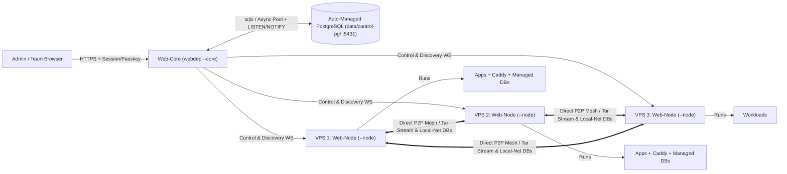
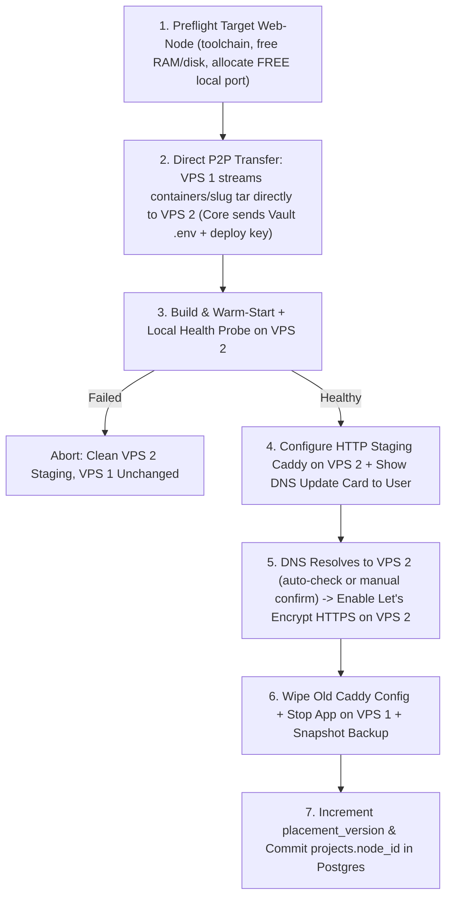

# WebDep Multi-Node Plan: **Web-Core** & **Web-Node**

This plan evolves WebDep into a unified two-component architecture—**Web-Core** (the brain) and **Web-Node** (the worker)—backed by a **zero-config PostgreSQL** control store, **direct peer-to-peer connections between all Web-Node VPSs**, **live app shifting**, and a dedicated **Access** tab for per-user and per-app permissions.

---

## 1. Unified Topology: **Web-Core** + **Web-Node** (Even on 1 VPS)

Every WebDep setup—whether a **single VPS** or a **20-VPS fleet**—uses the exact same clean split between **Web-Core** and **Web-Node** from the same Rust binary (`webdep`), keeping `src/updater.rs` and `start.sh` consistent everywhere.

- **Single VPS install (`./start.sh` default)**: Automatically installs, pairs, and starts **both `webdep-core.service` + `webdep-node.service`** on that VPS out of the box (no extra setup, and already 100% cluster-ready when you later add VPS #2 or #3).
- **Dedicated Control VPS (`./start.sh --core`)**: Runs **Web-Core** alone to host the panel/API while workloads live on remote **Web-Node** VPSs.
- **Additional Worker VPS (`./start.sh --node --join ...`)**: Runs **Web-Node** to build/host apps and connect directly into the **Web-Node** peer mesh + **Web-Core**.



### Component Roles
| Component | Service / Flag | Storage Used | Serves Web UI? | Responsibilities |
| :--- | :--- | :--- | :--- | :--- |
| **Web-Core** *(The Brain)* | `webdep-core.service` (`--core`) | **Auto-managed local PostgreSQL** in `data/control-pg/` on dedicated port (`5431`; `DATABASE_URL` optional) | **Yes** | Serves UI & API, auth/2FA/passkeys, **Access** RBAC, peer discovery/enrollment, shift coordination, audit logs, vault key management. |
| **Web-Node** *(The Worker)* | `webdep-node.service` (`--node`) | **Local manifest only** (`data/node-state.json`, zero Postgres dependency) | **No** | Clones/builds apps, runs containers, manages local Caddy & user DBs (`5432+`), maintains direct P2P mesh links with all other **Web-Node**s, streams metrics/logs to **Web-Core**. |

> **Why every VPS runs Web-Node (and Web-Node talks directly to peer Web-Nodes)**:
> 1. **Zero single-vs-multi-node code split**: A single VPS runs the exact same deploy/build/proxy pipeline as a multi-VPS cluster, so adding your second VPS never requires migrating your first VPS.
> 2. **Full direct speed & resilience**: App-to-DB queries and app-shift `.tar.gz` transfers flow **directly between Web-Node VPSs** without funneling through Web-Core. If Web-Core restarts briefly, running apps and direct node-to-node DB traffic stay live uninterrupted via `data/node-state.json`.

---

## 2. Database Architecture: Shifting SQLite -> Zero-Config PostgreSQL

Currently `src/db.rs` exposes `DbPool = Arc<Mutex<rusqlite::Connection>>` across 27+ source files, serializing queries behind one synchronous lock. Additionally, `PgBinaries::detect()` in `src/databases/binaries.rs` currently fails if PostgreSQL binaries are missing on the OS.

### Concrete Refactoring Strategy
1. **True Auto-Install & Isolated Port (`data/control-pg/`)**:
   - Users **never need to supply a `DATABASE_URL` or install PostgreSQL manually**.
   - `start.sh` automatically installs OS PostgreSQL (`apt`/`dnf`) if missing on Linux (and **Web-Core** verifies `PgBinaries::detect()` on startup).
   - **Web-Core** auto-initializes and supervises `data/control-pg/` bound to `127.0.0.1:5431` (explicitly separated from user-managed Postgres DBs on **Web-Node** starting at `5432+`, preventing single-VPS port collisions), generating credentials automatically into `data/control-pg/conn.json`.
2. **Async Repository Layer (`src/store/`) + `LISTEN/NOTIFY`**:
   - Replace `Arc<Mutex<rusqlite::Connection>>` with `sqlx::PgPool`, strict ordered SQL migrations (`migrations/*.sql`), and `LISTEN/NOTIFY` for instant cluster state, shift progress, and live ACL/WebSocket session revocation.
3. **Fast Log Buffering**:
   - Stream live build/runtime logs in-memory (`tokio::sync::broadcast` + Web-Node WS stream) and batch-flush `logs` inserts to PostgreSQL.
4. **Zero-Data-Loss Upgrade from `data/webdep.sqlite`**:
   - Built-in importer (`webdep --import-sqlite ./data/webdep.sqlite`, auto-run once if `webdep.sqlite` exists and Postgres `users` is empty) copies users, 2FA/passkeys, projects, encrypted `.env` secrets, deployments, releases, databases, and audit logs cleanly in one transaction.

---

## 3. Direct P2P Web-Node Mesh, Enrollment & Git/Exec Sync

1. **One-Command VPS Enrollment**:
   - **Web-Core** generates a single-use **Join Token** (15 min TTL, hashed in `node_enroll_tokens`).
   - On any fresh VPS:
     ```bash
     ./start.sh --node --join https://panel.yourdomain.com --token <enroll-token> --name vps-2
     ```
   - On a single VPS (`./start.sh`), installer silently pairs local `Web-Node` with local `Web-Core`.
   - Each **Web-Node** connects outbound over TLS WebSocket (`/api/cluster/node-ws`) to **Web-Core** for control commands, live telemetry (`src/monitor.rs` & `src/monitor_net.rs`), and peer discovery.
2. **Direct Web-Node <-> Web-Node Connection (Full Mesh + Auto-Whitelist)**:
   - Every **Web-Node** maintains **direct peer-to-peer connections** with every other **Web-Node** in the cluster (full encrypted WireGuard mesh over a single UDP port, assigning each VPS a stable `mesh_ip` like `10.200.0.x`, **plus** synced `ufw`/`nftables` & `pg_hba.conf` peer rules).
   - **No Web-Core middleman**: Database queries, internal microservice calls, and `.tar.gz` app transfers travel **directly from VPS to VPS**.
   - **Works behind cloud firewalls & avoids localhost blind spots**: Cross-node databases and internal services bind to `127.0.0.1` + the VPS's `mesh_ip` (`10.200.0.x`), while external internet traffic stays blocked. Because WireGuard authenticates by cryptographic peer key over one UDP port, nodes remain reachable even if public IPs change or cloud firewalls block raw Postgres ports.
   - When any **Web-Node** joins or leaves, **Web-Core** pushes the updated peer table and every **Web-Node** reconciles its direct WireGuard peers and allowlists automatically.
3. **Remote Git Ops, Private Keys & Live State Sync**:
   - Handlers in `src/api/projects/git_ops.rs` and `src/api/projects.rs` that inspect local `.git` repos and PIDs proxy via WS from **Web-Core** to the project's owning **Web-Node** (with commit metadata cached in Postgres).
   - **Private Repo Deploy Keys / Tokens**: Stored encrypted in **Web-Core**'s Vault and synced over TLS to whichever **Web-Node** currently hosts (or receives) the app.
4. **Split-Brain & Reconnect Guard (`placement_version`)**:
   - Every project assignment carries an incrementing `placement_version` in Postgres and in `data/node-state.json`. If a **Web-Node** goes offline while its app is moved elsewhere, when that old node reconnects it reconciles against **Web-Core**, sees its `placement_version` is stale, and cleanly stops the superseded local app without touching the active copy.

---

## 4. Live App Shifting ("Direct VPS-to-VPS Transfer")

### Cluster Schema in PostgreSQL
- `nodes`: `id`, `name`, `region`, `tags_json`, `status` (`online`/`offline`/`draining`), `public_ip`, `mesh_ip`, `wg_pubkey`, `wg_endpoint`, `node_version`, `capabilities_json`, `metrics_json`, `last_seen_at`, `created_at`.
- `projects.node_id`, `projects.placement_version`, `projects.assigned_port` (node-local), & `databases.node_id`.
- `migrations`: `id`, `project_id`, `from_node_id`, `to_node_id`, `stage`, `status`, `dns_verified_at`, `transfer_bytes`, `error`, `started_at`, `finished_at`.

### Simple, Safe Shift Pipeline (Direct P2P + 2-Stage Caddy/DNS Cutover)


- **Per-Node Port Allocation**: Target **Web-Node** allocates a guaranteed-free port on **VPS 2** (never reusing VPS 1's port if already occupied).
- **Direct Encrypted Node-to-Node Streaming**: Source **Web-Node** opens a direct mTLS/token-authenticated HTTP stream over the P2P mesh straight to Target **Web-Node** to copy `WebsiteContainer` (`data/containers/<slug>/`) with an optional brief maintenance pause + final delta sync so stateful uploads/SQLite files stay consistent.
- **2-Stage Caddy + Manual DNS Cutover (Avoiding Let's Encrypt Errors)**:
  1. Target **Web-Node** (**VPS 2**) binds an HTTP/ready route first (because Let's Encrypt HTTP-01 will fail if called *before* DNS points to VPS 2), while **VPS 1** keeps serving live traffic with zero downtime.
  2. **Web-Core** shows a clear **DNS Update Card** (`Type: A`, `Host/Domain`, `New IP: <VPS 2 Public IP>`, replacing `<VPS 1 Public IP>`) with an automatic DNS check (plus a manual *"Complete Cutover Now"* override).
  3. Once DNS points to VPS 2 (or user clicks complete), **VPS 2** activates automatic Let's Encrypt HTTPS in Caddy and **VPS 1 immediately wipes its old Caddy config** and stops the old process.
- **Direct Cross-Node Database Access**: Because every **Web-Node** has a direct auto-whitelisted connection to every other **Web-Node**, an app shifted to **VPS 2** can keep reading/writing its database or backend services on **VPS 1** directly over VPS 1's `mesh_ip` (`DATABASE_URL` updated automatically), or optionally run `pg_dump` + restore onto VPS 2.

---

## 5. Multi-Node Platform Features

- **Nodes View (`data-view="nodes"`)**: live **Web-Node** cards (CPU/RAM/Disk/Net, peer mesh latency/status, workload count, **Drain Node** button to move apps off cleanly, **Add Node** join command generator).
- **Cluster Filter Everywhere**: `All Nodes` vs specific **Web-Node** selector across Overview, Websites, Services, Databases, and Resource Breakdown.
- **Coordinated Fleet & Legacy Upgrades**:
  - One-click update upgrades connected **Web-Node** daemons first, then restarts **Web-Core** (`src/updater.rs` + `start.sh` updated to manage `webdep-core.service` + `webdep-node.service`).
  - Existing single-binary `webdep.service` installs seamlessly migrate into `webdep-core.service` + `webdep-node.service` during `./start.sh --update`.
- **Off-Node Backups (S3 / Web-Core)**: store snapshots off the worker VPS so a failed VPS never loses backups, and allow restoring onto *any* healthy **Web-Node**.

---

## 6. Dedicated `Access` Tab (Per-User, Per-App, Per-Node RBAC)

Currently user management lives inside `public/js/settings_users.js` + `src/auth/user.rs` with one flat `users.permissions` array across `users.allowed_projects`.

### PostgreSQL ACL Model (`access_grants`)
- Columns: `id`, `user_id`, `scope_type` (`global` | `node` | `project` | `database`), `scope_id`, `role_preset` (`viewer` | `deployer` | `operator` | `maintainer` | `custom`), `powers_json`, `granted_by`, `expires_at`, `created_at`, `updated_at`.
- Unique index on `(user_id, scope_type, COALESCE(scope_id, 0))`.
- `verify_power` in `src/api/common.rs` checks explicit resource grant `(user_id, scope_type, scope_id)` first (ignoring expired grants), then `global` grant; Main Admin retains full access.
- **Cross-Node Move Rule**: Moving an app between nodes requires deploy/shift permission on the app **and** access to the target **Web-Node**.
- **Instant Live Revocation**: Updating or expiring a grant emits a Postgres `NOTIFY`, closing any active WebSocket log/terminal streams for that revoked user/resource immediately.

### Dedicated `Access` Tab (`data-view="access"` under Administration)
1. **By User**: manage credentials, 2FA/Passkeys, active session revocation, **Allowed Nodes**, and a **Per-App Access Matrix** assigning distinct roles/powers and optional expiry (`24h`, `7d`, `Permanent`) per website/service/database.
2. **By App / Resource**: pick any Website, Service, Database, or **Web-Node** to view *"Who has access?"* and grant, downgrade, or revoke access in one click.
3. **Role Templates & Access Audit**: reusable capability presets (`Frontend Deployer`, `Support Read-Only`, `DB Operator`, `Node Maintainer`) plus a dedicated **Access Audit Feed**.

---

## 7. Recommended Implementation Order

1. **Phase 1 — SQLite -> Zero-Config PostgreSQL + Automated Importer (`Web-Core` Foundation)**:
   - Update `start.sh` / Postgres bootstrap for auto-install and isolated `data/control-pg/` port (`5431`), add `sqlx` (`postgres` + `migrate` + `LISTEN/NOTIFY`), convert `DbPool` -> `PgPool` repository layer, and ship `webdep.sqlite` auto-importer.
2. **Phase 2 — Dedicated `Access` Tab & `access_grants` Engine**:
   - Implement `access_grants` migrations, per-app/per-node `verify_power` + WS live-revocation, and the **Access** UI (`By User`, `By App`, `Role Templates`, `Expiring Grants`).
3. **Phase 3 — `Web-Core` / `Web-Node` Split, Direct P2P Mesh & `Nodes` View**:
   - Split `--core` (`webdep-core.service`) and `--node` (`webdep-node.service`), migrate legacy `webdep.service` + pair single-VPS installs automatically, add `--join` enrollment, direct WireGuard P2P mesh + firewall/`pg_hba` auto-whitelist, and the **Nodes** view.
4. **Phase 4 — Remote Execution Proxy**:
   - Route deploys, start/stop, logs streaming, Git checks/keys, `.env` sync, Caddy config, and file browser transparently from **Web-Core** to each project's active **Web-Node** (with `placement_version` reconciliation).
5. **Phase 5 — Direct P2P App Shifting (`Move to Node`) & Fleet Ops**:
   - Free-port allocation on Target, direct VPS-to-VPS container tar streaming, health probe, 2-stage Caddy + DNS Update Card + automatic HTTPS & Source Caddy wipe, node draining, coordinated fleet updates, and off-node backups.
