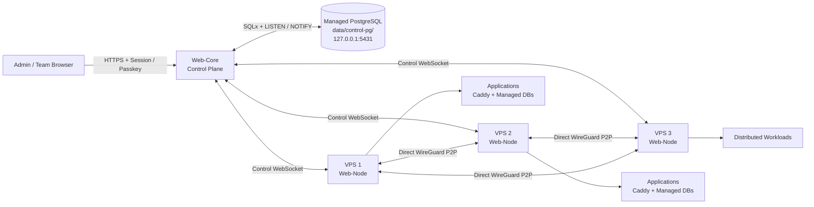
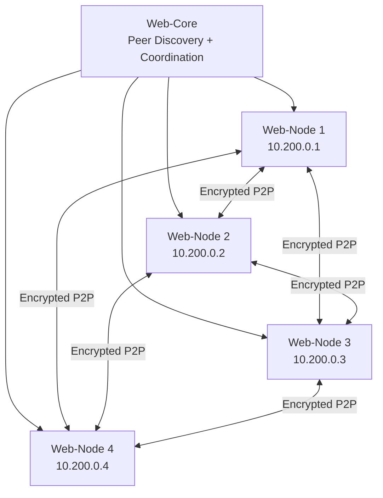
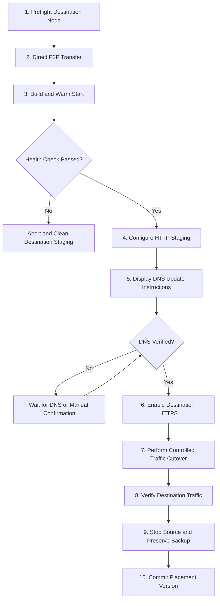

# WebDep Multi-Node Architecture & Implementation Plan

**Architecture:** Web-Core + Web-Node  
**Database:** Zero-Configuration PostgreSQL  
**Networking:** Direct WireGuard P2P Mesh  
**Deployment:** Distributed Multi-Node Workloads  
**Authorization:** Per-User, Per-App, Per-Node RBAC  
**Implementation:** Phased Migration

---

## Table of Contents

1. [Architecture Overview](#1-architecture-overview)
2. [Database Architecture: SQLite to PostgreSQL](#2-database-architecture-sqlite-to-postgresql)
3. [Web-Node Enrollment and Direct P2P Mesh](#3-web-node-enrollment-and-direct-p2p-mesh)
4. [Live Application Shifting](#4-live-application-shifting)
5. [Multi-Node Platform Features](#5-multi-node-platform-features)
6. [Access Management and RBAC](#6-access-management-and-rbac)
7. [Implementation Roadmap](#7-implementation-roadmap)
8. [Architecture Invariants and Acceptance Criteria](#8-architecture-invariants-and-acceptance-criteria)

---

# 1. Architecture Overview

## 1.1. Unified Web-Core + Web-Node Architecture

WebDep will evolve into a unified two-component architecture consisting of:

- **Web-Core:** The central control plane and management brain.
- **Web-Node:** The distributed worker responsible for application hosting and execution.

Both components must be built from the same Rust binary (`webdep`).

Every WebDep installation must follow the same architecture, regardless of whether it runs on a single VPS or across a distributed fleet of 20+ VPS instances.

There must be no separate single-node and multi-node deployment pipelines.

A single-VPS installation must already use the same Core/Node separation as a distributed installation. Adding another VPS must not require migrating or restructuring the existing installation.

### Installation Modes

| Installation Mode | Command | Components | Purpose |
|---|---|---|---|
| Default installation | `./start.sh` | Web-Core + Web-Node | Complete single-VPS installation |
| Dedicated control plane | `./start.sh --core` | Web-Core | Centralized management server |
| Additional worker | `./start.sh --node --join ...` | Web-Node | Additional application hosting VPS |

### Installation Requirements

**Default installation (`./start.sh`)**

- Automatically installs and initializes Web-Core.
- Automatically installs and initializes Web-Node.
- Pairs the local Web-Node with the local Web-Core.
- Creates and starts both systemd services.
- Requires no additional cluster configuration.
- Remains compatible with future multi-node expansion.

**Dedicated control VPS (`./start.sh --core`)**

- Runs Web-Core independently.
- Hosts the management dashboard and API.
- Manages authentication, authorization, node discovery, and cluster coordination.
- Does not need to host application workloads.

**Additional worker VPS (`./start.sh --node --join ...`)**

- Installs Web-Node.
- Enrolls with an existing Web-Core.
- Establishes its WireGuard mesh connectivity.
- Receives deployment and workload assignments.
- Communicates directly with other Web-Nodes.

## 1.2. High-Level Architecture



## 1.3. Component Responsibilities

| Component | Service / Flag | Storage | Serves UI? | Responsibilities |
|---|---|---|---|---|
| **Web-Core** | `webdep-core.service` / `--core` | Managed PostgreSQL | Yes | Dashboard, API, authentication, RBAC, node discovery, enrollment, deployment coordination, audit logs, vault management |
| **Web-Node** | `webdep-node.service` / `--node` | `data/node-state.json` | No | Application builds, deployments, containers, Caddy, local databases, resource monitoring, P2P connectivity |

### Web-Core: The Brain

Web-Core is responsible for:

- Serving the WebDep dashboard and management API.
- User authentication, 2FA, and passkey management.
- Access control and RBAC enforcement.
- Node registration, discovery, and enrollment.
- Deployment and application placement coordination.
- Application shifting orchestration.
- Encrypted secret and credential management.
- Audit logging.
- Cluster-wide configuration and state management.
- WebSocket session management and revocation.
- Fleet-wide updates and backup coordination.

Web-Core must not become a bottleneck for application-to-application communication or application data transfers.

### Web-Node: The Worker

Web-Node is responsible for:

- Cloning Git repositories.
- Building and deploying applications.
- Managing application containers and processes.
- Managing local Caddy instances and configurations.
- Managing user application databases.
- Running health checks.
- Streaming application logs and metrics.
- Maintaining local workload state.
- Establishing direct WireGuard connections with other Web-Nodes.
- Performing direct application and database communication.
- Executing application migration and transfer operations.

Web-Node must remain operational when Web-Core becomes temporarily unavailable.

Running applications and established peer-to-peer database connections must not depend on Web-Core being continuously available.

### Architectural Principle

> Web-Core controls the cluster. Web-Nodes execute workloads. Web-Nodes communicate directly whenever the operation does not require centralized coordination.

---

# 2. Database Architecture: SQLite to Zero-Configuration PostgreSQL

## 2.1. Current Limitations

The current implementation uses:

`src/db.rs`

The existing database abstraction exposes:

```rust
pub type DbPool = Arc<Mutex<rusqlite::Connection>>;
```

This creates several limitations:

- Database queries are serialized behind a single synchronous mutex.
- Concurrent requests compete for the same connection.
- Blocking SQLite operations can interfere with asynchronous request processing.
- Scaling database operations across multiple Web-Core processes becomes difficult.
- Real-time cluster coordination requires additional infrastructure.

Additionally, the current PostgreSQL binary detection implementation:

`src/databases/binaries.rs`

contains:

```rust
PgBinaries::detect()
```

Currently, startup can fail when PostgreSQL binaries are not installed.

The new architecture must eliminate these limitations.

## 2.2. Zero-Configuration PostgreSQL

Web-Core must automatically initialize and manage its own isolated PostgreSQL instance.

Users must not be required to:

- Install PostgreSQL manually.
- Configure PostgreSQL manually.
- Create database users manually.
- Supply a `DATABASE_URL`.
- Configure database ports manually.

### PostgreSQL Installation

`start.sh` must:

1. Detect the operating system.
2. Check whether PostgreSQL binaries are available.
3. Install missing PostgreSQL dependencies using the supported package manager.
4. Initialize the isolated control-plane PostgreSQL data directory.
5. Generate secure database credentials.
6. Configure PostgreSQL to listen exclusively on `127.0.0.1:5431`.
7. Start and verify the managed PostgreSQL instance.
8. Persist connection information securely.

Supported package-manager detection should include:

- `apt` / `apt-get`
- `dnf`
- Other explicitly supported Linux distributions as needed.

### Isolated Directory Structure

```text
data/
├── control-pg/
│   ├── data/
│   ├── conn.json
│   ├── logs/
│   └── backups/
│
├── node-state.json
│
├── containers/
│
├── databases/
│
└── backups/
```

### Port Separation

| Service | Port | Binding |
|---|---:|---|
| Web-Core PostgreSQL | 5431 | `127.0.0.1` |
| Web-Node application PostgreSQL | 5432+ | Local and authorized mesh interfaces |
| Web-Node application services | Dynamically allocated | Local and authorized mesh interfaces |

The control-plane PostgreSQL instance must remain isolated from user-managed application databases.

The port allocation system must prevent collisions.

### Credential Management

Generate strong random credentials automatically.

Persist connection information in:

`data/control-pg/conn.json`

Requirements:

- Restrict file permissions.
- Never expose credentials through API responses.
- Never print credentials in application logs.
- Never commit generated credentials to Git.
- Support credential rotation.

## 2.3. Asynchronous Repository Architecture

Replace the existing SQLite abstraction with:

```rust
sqlx::PgPool
```

Introduce a dedicated repository layer.

Proposed structure:

```text
src/
├── store/
│   ├── mod.rs
│   ├── pool.rs
│   ├── users.rs
│   ├── projects.rs
│   ├── deployments.rs
│   ├── databases.rs
│   ├── nodes.rs
│   ├── access.rs
│   ├── migrations.rs
│   ├── audit.rs
│   └── logs.rs
│
migrations/
├── 0001_initial_schema.sql
├── 0002_users.sql
├── 0003_projects.sql
├── 0004_deployments.sql
├── 0005_nodes.sql
└── 0006_access_grants.sql
```

### Requirements

- Replace `Arc<Mutex<rusqlite::Connection>>` across all 31 affected source files.
- Use SQLx asynchronous queries.
- Use a shared, bounded PostgreSQL connection pool.
- Introduce transaction-based repository operations.
- Use ordered SQL migrations.
- Add appropriate indexes for frequently accessed data.
- Avoid unnecessary database queries.
- Use prepared statements and parameterized queries.
- Keep database operations out of blocking Tokio execution paths.

### LISTEN / NOTIFY

Use PostgreSQL `LISTEN / NOTIFY` for lightweight event propagation.

Required event categories:

- Node online/offline status.
- Node enrollment and removal.
- Application placement changes.
- Deployment progress.
- Application migration progress.
- Access permission updates.
- Session revocation.
- Cluster configuration updates.

Notifications should carry identifiers and event metadata rather than large payloads.

Consumers must be able to recover from missed notifications by reconciling against persistent PostgreSQL state.

## 2.4. Efficient Log Buffering

Live logs must not require an individual PostgreSQL write for every emitted log line.

Use:

```rust
tokio::sync::broadcast
```

Architecture:

1. Web-Node captures application build and runtime logs.
2. Logs are published through an in-memory broadcast channel.
3. Authorized WebSocket clients receive live log events.
4. Web-Core receives log streams when persistence or centralized visibility is required.
5. PostgreSQL inserts are performed in batches.

Requirements:

- Bounded buffers.
- Backpressure handling.
- Log rotation and retention.
- Protection against unbounded memory consumption.
- Graceful handling of disconnected consumers.
- Persistent logs must not be silently discarded.

## 2.5. Zero-Data-Loss SQLite Migration

Existing installations must migrate automatically from:

`data/webdep.sqlite`

The migration must preserve:

- Users.
- Password and authentication metadata.
- 2FA configuration.
- Passkeys and credential metadata.
- Projects.
- Allowed project assignments.
- Encrypted environment variables.
- Deployments.
- Releases.
- Managed databases and metadata.
- Audit logs.
- Existing configuration.

### Importer

Support:

```bash
./webdep --import-sqlite ./data/webdep.sqlite
```

Additionally, automatically detect and execute the importer during startup when:

1. `data/webdep.sqlite` exists.
2. PostgreSQL is initialized.
3. The PostgreSQL database has no imported user data.
4. No completed migration marker exists.

### Migration Safety

- Perform the import within a transaction where practical.
- Preserve encrypted values without accidentally decrypting or re-encrypting them incorrectly.
- Validate imported record counts.
- Preserve primary keys and relationships.
- Detect duplicate records.
- Maintain a migration completion marker.
- Never delete the original SQLite database automatically.
- Produce an import report.
- Support safe recovery after an interrupted import.

The original SQLite database must remain available until the migration has been verified.

---

# 3. Web-Node Enrollment and Direct P2P Mesh

## 3.1. One-Command Node Enrollment

Web-Core must provide a secure, single-use enrollment token.

Token requirements:

- 15-minute expiration.
- Cryptographically random.
- Stored as a hash in PostgreSQL.
- Single-use.
- Revocable.
- Bound to the intended enrollment process.
- Protected against replay attacks.

Proposed enrollment table:

`node_enroll_tokens`

Suggested fields:

- `id`
- `token_hash`
- `created_by`
- `expires_at`
- `used_at`
- `revoked_at`
- `created_at`

### Enrollment Command

Web-Core generates a command similar to:

```bash
./start.sh \
  --node \
  --join https://panel.yourdomain.com \
  --token <enrollment-token> \
  --name vps-2
```

### Enrollment Workflow

1. Administrator generates a node enrollment token.
2. Web-Core stores its hash and expiration.
3. Administrator executes the enrollment command on the new VPS.
4. Web-Node connects to Web-Core using TLS.
5. Web-Core validates the token.
6. Web-Node generates its persistent identity and WireGuard key pair.
7. Web-Core registers the node.
8. Web-Core provisions peer information.
9. Web-Node establishes its mesh connectivity.
10. Web-Core marks the node online after successful verification.

A node must not be considered fully operational until its identity and required connectivity have been verified.

## 3.2. Core-to-Node Communication

Each Web-Node establishes an outbound TLS WebSocket connection to:

```text
/api/cluster/node-ws
```

The connection supports:

- Control commands.
- Deployment coordination.
- Node discovery.
- Heartbeats.
- CPU/RAM/disk/network telemetry.
- Application health information.
- Log streaming.
- Configuration synchronization.
- Peer discovery.
- Placement reconciliation.

Existing monitoring modules should be reused where practical:

```text
src/monitor.rs
src/monitor_net.rs
```

Web-Node must reconnect automatically when Web-Core becomes unavailable.

Reconnects must use bounded exponential backoff with jitter.

## 3.3. Direct Web-Node-to-Web-Node Mesh

All registered Web-Nodes must maintain direct encrypted connectivity with their authorized peers.

Use WireGuard as the underlying mesh transport.

### Mesh Architecture



### WireGuard Requirements

Each Web-Node must have:

- A persistent WireGuard key pair.
- A stable mesh IP.
- A unique node identity.
- An authorized peer table.
- A configured UDP endpoint.
- Automatic peer reconciliation.

Example mesh addresses:

```text
10.200.0.1
10.200.0.2
10.200.0.3
10.200.0.4
```

### Dynamic Peer Reconciliation

Whenever a Web-Node joins, leaves, or changes its endpoint:

1. Web-Core updates cluster membership.
2. Web-Core distributes the updated peer information.
3. Each Web-Node reconciles its local WireGuard configuration.
4. Firewall rules are updated.
5. Database access rules are reconciled.
6. Connectivity is verified.
7. Updated peer status is reported to Web-Core.

Web-Nodes must reject unauthorized peers even if they can reach the WireGuard endpoint.

### Firewall and Database Security

Integrate mesh connectivity with:

- `ufw`
- `nftables`
- PostgreSQL `pg_hba.conf`
- Existing database security logic.

Reuse:

```text
src/databases/security.rs
```

In particular:

```rust
generate_pg_hba()
```

Application databases must remain inaccessible from the public internet.

Database traffic should be restricted to:

- Localhost.
- Explicitly authorized WireGuard mesh addresses.
- Explicitly authorized internal services.

Do not expose PostgreSQL ports publicly.

### Direct Communication Requirements

The following operations must bypass Web-Core as a data-transfer intermediary:

- Application-to-database traffic.
- Internal application service communication.
- Application archive transfers.
- Build artifact transfers.
- Direct peer health checks.
- Authorized internal API calls.

Web-Core remains responsible for authorization, coordination, and peer discovery.

### Network Resilience

The implementation must distinguish between:

- Direct public UDP connectivity.
- NAT traversal.
- Cloud firewall restrictions.
- Static and dynamic public IPs.
- WireGuard endpoint roaming.
- Relay-based fallback when direct connectivity cannot be established.

A single UDP port does not guarantee connectivity through every firewall or NAT configuration. The system must detect unreachable peers and report their connectivity state accurately.

## 3.4. Remote Git Operations

Currently, some API operations inspect local Git repositories and process state directly inside the API process.

Relevant handlers:

```text
src/api/projects/git_ops.rs
src/api/projects.rs
```

Examples:

```rust
project_commits_handler()
list_projects_handler()
```

Under the new architecture, Web-Core must not assume that project files or Git repositories exist locally.

Instead:

1. Web-Core identifies the project's owning Web-Node.
2. Web-Core authorizes the requested operation.
3. Web-Core sends the operation to the owning Web-Node.
4. Web-Node performs the Git operation locally.
5. Web-Node returns structured results.
6. Web-Core caches appropriate metadata in PostgreSQL.

This applies to:

- Commit history.
- Branch information.
- Repository status.
- Deployment history.
- Git operations.
- Repository metadata.

## 3.5. Private Repository Credentials

Private Git credentials must be managed centrally through the Web-Core Vault.

Requirements:

- Encrypt credentials at rest.
- Never expose raw credentials through the dashboard API.
- Deliver credentials only to authorized Web-Nodes.
- Scope credentials to the required project and operation.
- Support credential rotation and revocation.
- Avoid persistent unnecessary copies on workers.

When an application moves to another Web-Node, the required credentials must be securely provisioned to the destination.

## 3.6. Placement Version and Split-Brain Protection

Every project assignment must contain:

```text
placement_version
```

This value must be stored in:

- PostgreSQL.
- `data/node-state.json` on the owning Web-Node.

Whenever an application's placement changes, the placement version must increment.

### Reconciliation Example

```text
Project: website-1

Web-Core:
  node_id = node-2
  placement_version = 8

Old Web-Node:
  node_id = node-1
  placement_version = 7
```

When node-1 reconnects:

1. Web-Node retrieves the authoritative project assignment.
2. It compares its local placement version with Web-Core.
3. It identifies the stale assignment.
4. It stops the superseded local workload.
5. It cleans up stale proxy configuration.
6. It retains or removes local data according to the migration recovery policy.

A stale Web-Node must never overwrite a newer project assignment.

Placement changes must use transactional updates and idempotent reconciliation.

---

# 4. Live Application Shifting

## 4.1. Objective

WebDep must support moving a running application between Web-Nodes without routing application archive transfers through Web-Core.

Example:

```text
Source:
  VPS 1 / Web-Node 1

Destination:
  VPS 2 / Web-Node 2
```

The operation must preserve application configuration, deployment state, required data, and routing configuration.

## 4.2. Cluster Database Schema

The PostgreSQL control store must maintain cluster placement and migration metadata.

### Nodes Table

```text
nodes
-----
id
name
region
tags_json
status
public_ip
mesh_ip
wg_pubkey
wg_endpoint
node_version
capabilities_json
metrics_json
last_seen_at
created_at
updated_at
```

Supported node statuses:

- `online`
- `offline`
- `draining`
- `maintenance`
- `unhealthy`

### Project Placement

Add the following fields to projects:

```text
projects
--------
node_id
placement_version
assigned_port
```

Database placement must similarly track:

```text
databases
---------
node_id
```

### Migration Tracking

```text
migrations
----------
id
project_id
from_node_id
to_node_id
stage
status
dns_verified_at
transfer_bytes
error
started_at
finished_at
```

Suggested stages:

- `preflight`
- `transfer`
- `build`
- `health_check`
- `staging`
- `dns_verification`
- `cutover`
- `cleanup`
- `completed`
- `rollback`

## 4.3. Application Shift Workflow



## 4.4. Stage 1: Destination Preflight

Before transferring anything, the destination Web-Node must verify:

- Node is online.
- Required runtime is available.
- Required build toolchains are installed.
- Sufficient RAM is available.
- Sufficient disk space is available.
- Required network connectivity exists.
- Required application dependencies are available.
- A free application port can be allocated.
- Required databases and secrets can be provisioned.

If preflight fails, the operation must stop without modifying the source workload.

## 4.5. Stage 2: Direct P2P Transfer

The source Web-Node transfers application data directly to the destination Web-Node.

Transfer:

```text
data/containers/<slug>/
```

Use a streamed archive format such as:

```text
.tar.gz
```

Requirements:

- Direct WireGuard mesh transfer.
- Authenticated source and destination.
- Encrypted transport.
- Streaming instead of loading the complete archive into memory.
- Transfer progress reporting.
- Checksum verification.
- Retry support.
- Temporary staging directories.
- Safe cleanup after failed transfers.

The transfer must not pass through Web-Core.

### Stateful Application Consistency

For applications containing mutable files, uploads, SQLite databases, or other stateful data:

1. Perform an initial data transfer.
2. Keep the source application serving traffic.
3. Synchronize changed files where supported.
4. Enter a short maintenance or write-pause window when necessary.
5. Perform a final delta synchronization.
6. Verify data integrity.
7. Resume operations after a successful cutover.

Application data must never be assumed to be consistent merely because the initial archive transfer completed.

## 4.6. Stage 3: Build and Warm Start

The destination Web-Node must:

1. Restore application files.
2. Provision the required environment variables.
3. Provision authorized Git credentials.
4. Configure the required database connections.
5. Build the application.
6. Start the application on the destination port.
7. Execute local health checks.

The source workload must remain unchanged.

If any operation fails, the destination staging workload must be cleaned up and the migration marked as failed.

## 4.7. Stage 4: HTTP Staging and DNS Preparation

Before switching traffic:

- Configure the destination Caddy instance.
- Enable an HTTP readiness route.
- Verify the application through the destination.
- Keep the source VPS serving production traffic.

Web-Core must display a DNS Update Card.

### DNS Update Information

| Field | Value |
|---|---|
| Record Type | `A` |
| Domain | Application domain |
| Host | Existing DNS hostname |
| Previous IP | Source VPS public IP |
| New IP | Destination VPS public IP |
| Status | Waiting for DNS verification |

The dashboard must support:

- Automatic DNS verification.
- Manual DNS verification.
- Manual cutover override.
- Migration status visibility.

## 4.8. Stage 5: HTTPS Activation and Traffic Cutover

Once DNS resolves to the destination:

1. Destination Web-Node activates HTTPS configuration.
2. Caddy obtains or validates the required certificate.
3. Destination application health is verified.
4. Traffic is switched to the destination.
5. The destination is monitored for successful production traffic.
6. The source is stopped only after cutover verification.

### Important Cutover Requirement

DNS changes are not instantaneous.

The implementation must account for:

- DNS TTL.
- Cached DNS responses.
- Existing client connections.
- Existing TLS certificate validity.
- Reverse-proxy behavior.
- Source and destination traffic overlap.

A manual cutover override must not blindly stop the source application.

The source must remain available until the destination has passed the required verification checks.

The system must preserve a rollback path.

## 4.9. Stage 6: Database Migration and Cross-Node Connectivity

After an application moves to VPS 2, it must be able to continue accessing its database on VPS 1 if required.

Example:

```text
Application:
  VPS 2 / Web-Node 2

Database:
  VPS 1 / Web-Node 1

Connection:
  Direct WireGuard Mesh
```

Possible strategies:

**Option A: Keep the database on the source node**

- Application connects through the source node's mesh IP.
- Database remains local to its existing Web-Node.
- No immediate database migration is required.

**Option B: Move the database**

- Execute `pg_dump`.
- Transfer the dump directly over the mesh.
- Restore it on the destination.
- Verify database consistency.
- Update application connection configuration.
- Perform a controlled database cutover.

The system must explicitly track database placement and application-to-database dependencies.

## 4.10. Stage 7: Placement Commit and Cleanup

After successful migration:

1. Verify the destination workload.
2. Verify traffic routing.
3. Verify required database connectivity.
4. Increment `placement_version`.
5. Update `projects.node_id`.
6. Commit placement changes transactionally.
7. Update node-local manifests.
8. Remove obsolete source Caddy configuration.
9. Stop the source application.
10. Preserve a recovery snapshot according to retention policy.

A failed migration must never result in both nodes independently claiming authoritative ownership of the same application.

---

# 5. Multi-Node Platform Features

## 5.1. Nodes Dashboard

Introduce a dedicated Nodes view:

```html
data-view="nodes"
```

Each Web-Node card must display:

- Node name.
- Node ID.
- Region.
- Public IP.
- Mesh IP.
- Online/offline status.
- CPU usage.
- RAM usage.
- Disk usage.
- Network throughput.
- Mesh connectivity.
- Peer latency.
- Running workload count.
- Node software version.
- Last heartbeat.
- Health status.

### Node Actions

- View node details.
- Generate enrollment command.
- Drain node.
- Move applications.
- Restart node agent.
- Update node.
- Remove node.
- View node logs.

### Drain Node

The Drain Node action must:

1. Mark the node as draining.
2. Prevent new workload assignments.
3. Identify existing workloads.
4. Identify database dependencies.
5. Find suitable destination nodes.
6. Move workloads using the migration workflow.
7. Verify successful relocation.
8. Confirm that the node has no remaining workloads.
9. Allow safe removal or maintenance.

A node must not be removed while it still hosts active workloads or required data.

## 5.2. Cluster-Wide Filters

Introduce an All Nodes selector across:

- Overview.
- Websites.
- Services.
- Databases.
- Resource Breakdown.
- Deployments.
- Monitoring.

Supported selections:

```text
All Nodes
VPS 1
VPS 2
VPS 3
...
```

The selected node must consistently filter relevant data across the dashboard.

## 5.3. Coordinated Fleet Updates

The updater must support coordinated updates across Web-Core and all registered Web-Nodes.

Relevant files:

```text
src/updater.rs
start.sh
```

### Update Sequence

1. Verify cluster health.
2. Check node compatibility.
3. Download and verify the new release.
4. Update Web-Nodes in a controlled order.
5. Verify each updated node.
6. Preserve workload availability.
7. Update Web-Core.
8. Restart Web-Core if required.
9. Verify cluster connectivity.
10. Report update completion.

The updater must support:

- Version compatibility checks.
- Rollback where possible.
- Partial update recovery.
- Node-by-node status reporting.
- Safe service restarts.

### Legacy Installation Migration

Existing installations using:

```text
webdep.service
```

must migrate automatically to:

```text
webdep-core.service
webdep-node.service
```

This must happen during:

```bash
./start.sh --update
```

The migration must preserve:

- Existing configuration.
- Existing data.
- Existing systemd settings where appropriate.
- Existing ports.
- Existing application workloads.

## 5.4. Off-Node Backups

Introduce backup storage independent of the source Web-Node.

Supported targets:

- S3-compatible object storage.
- Dedicated backup storage.
- Web-Core-managed backup storage where appropriate.

Requirements:

- Automated snapshots.
- Retention policies.
- Backup integrity verification.
- Encryption at rest.
- Off-node storage.
- Restore onto any healthy Web-Node.
- Database-aware backups.
- Application file backups.
- Configuration backups.

A VPS failure must not automatically result in the loss of its only available backup.

---

# 6. Access Management and RBAC

## 6.1. Current Limitations

User management currently exists inside:

```text
public/js/settings_users.js
src/auth/user.rs
```

The existing model primarily relies on:

- A flat `users.permissions` array.
- `users.allowed_projects`.

This is insufficient for a distributed multi-node environment.

WebDep requires centralized, resource-scoped authorization.

Introduce a dedicated **Access** administration tab.

## 6.2. PostgreSQL Access Grants Model

Create:

```text
access_grants
```

Suggested schema:

| Column | Description |
|---|---|
| `id` | Grant identifier |
| `user_id` | User receiving access |
| `scope_type` | `global`, `node`, `project`, or `database` |
| `scope_id` | Resource identifier; nullable for global scope |
| `role_preset` | `viewer`, `deployer`, `operator`, `maintainer`, or `custom` |
| `powers_json` | Explicit capabilities |
| `granted_by` | Granting administrator |
| `expires_at` | Optional expiration |
| `created_at` | Creation timestamp |
| `updated_at` | Last update timestamp |

Add a unique index for the appropriate resource scope.

For PostgreSQL, use a partial unique index for global grants and a separate unique index for non-global resource grants rather than relying on ordinary uniqueness with nullable columns.

## 6.3. Authorization Resolution

Update:

```text
src/api/common.rs
```

Relevant function:

```rust
verify_power()
```

Authorization resolution must follow this order:

1. Authenticate the requesting user.
2. Verify that the account and session are active.
3. Check the explicit resource-level grant.
4. Ignore expired or revoked grants.
5. Fall back to an applicable global grant.
6. Evaluate the requested capability.
7. Deny access if no valid grant authorizes the operation.

The Main Admin retains unrestricted access.

### Supported Scope Types

| Scope | Description |
|---|---|
| `global` | Access across the entire WebDep installation |
| `node` | Access to a specific Web-Node |
| `project` | Access to a specific website or service |
| `database` | Access to a specific managed database |

### Role Templates

| Role | Intended Permissions |
|---|---|
| `viewer` | Read-only access to authorized resources |
| `deployer` | Build and deploy authorized applications |
| `operator` | Start, stop, restart, and inspect workloads |
| `maintainer` | Manage authorized resources and configurations |
| `custom` | Individually selected capabilities |

Role presets must map to explicit capabilities.

The UI must never be treated as an authorization boundary. Every protected API and WebSocket operation must independently enforce permissions.

## 6.4. Cross-Node Application Move Authorization

Moving an application between nodes requires:

- Permission to deploy or shift the application.
- Access to the source resource.
- Access to the destination Web-Node.
- Permission to execute the requested migration operation.

Authorization must be checked again before the final placement commit.

A user who can manage an application on one node must not automatically gain access to every other node.

## 6.5. Instant Permission Revocation

Access changes must take effect immediately for new requests and active sessions.

Use PostgreSQL `LISTEN / NOTIFY` to propagate:

- Grant creation.
- Grant updates.
- Grant expiration.
- Grant revocation.
- Session revocation.

When an active user's permission is revoked:

1. Web-Core receives the notification.
2. Relevant authorization caches are invalidated.
3. Active WebSocket sessions are checked.
4. Unauthorized log streams are closed.
5. Unauthorized terminal sessions are closed.
6. Further API operations are denied.

Web-Node must also enforce authorization for sensitive worker operations.

A notification alone must not be the only enforcement mechanism. Sensitive operations must validate current authorization or a securely versioned authorization lease.

## 6.6. Dedicated Access Tab

Add:

```html
data-view="access"
```

Place it under Administration.

The Access tab must contain four main sections.

### A. By User

Allow administrators to:

- View users.
- Manage user credentials.
- Manage 2FA and passkeys.
- Revoke active sessions.
- Assign allowed nodes.
- Assign application permissions.
- Assign database permissions.
- Configure role presets.
- Set grant expiration.
- Review user-specific audit history.

Include a per-resource access matrix.

Example:

| Resource | Type | Assigned Role | Expiration |
|---|---|---|---|
| Website A | Project | Deployer | Permanent |
| Website B | Project | Viewer | 7 days |
| VPS 2 | Node | Operator | Permanent |
| Database A | Database | Viewer | 24 hours |

Supported expiration options:

- 24 hours.
- 7 days.
- Permanent.
- Custom expiration.

### B. By App / Resource

Allow administrators to select:

- Website.
- Service.
- Database.
- Web-Node.

Display:

**Who has access?**

For each user, show:

- User identity.
- Assigned role.
- Granted capabilities.
- Granting administrator.
- Expiration.
- Current access status.

Available actions:

- Grant access.
- Upgrade role.
- Downgrade role.
- Edit capabilities.
- Set expiration.
- Revoke access.

### C. Role Templates

Support reusable templates:

- Frontend Deployer.
- Support Read-Only.
- Database Operator.
- Node Maintainer.

Administrators must be able to create custom templates and modify their capability mappings.

### D. Access Audit Feed

Record:

- Grant creation.
- Grant updates.
- Grant revocation.
- Role changes.
- Permission expiration.
- Session revocation.
- Unauthorized access attempts.
- Administrative access changes.

Audit records must identify the actor, affected user, resource, action, and timestamp.

---

# 7. Implementation Roadmap

Implementation must follow the sequence below to minimize architectural conflicts and migration risk.

Each phase must be independently testable and must not compromise existing single-VPS installations.

## Phase 1 — SQLite to Zero-Configuration PostgreSQL

**Objective:** Establish the Web-Core database foundation.

### Tasks

- [ ] Implement PostgreSQL dependency detection.
- [ ] Implement automatic PostgreSQL installation.
- [ ] Initialize isolated `data/control-pg/`.
- [ ] Bind control PostgreSQL to `127.0.0.1:5431`.
- [ ] Generate secure credentials automatically.
- [ ] Implement managed PostgreSQL lifecycle.
- [ ] Add SQLx PostgreSQL dependencies.
- [ ] Introduce `PgPool`.
- [ ] Create the asynchronous repository layer.
- [ ] Add ordered SQL migrations.
- [ ] Refactor all 31 source files using the existing SQLite abstraction.
- [ ] Implement PostgreSQL `LISTEN / NOTIFY`.
- [ ] Implement batched log persistence.
- [ ] Implement SQLite importer.
- [ ] Validate migrated records and relationships.
- [ ] Preserve the original SQLite database.
- [ ] Test fresh installation.
- [ ] Test existing installation upgrade.
- [ ] Test interrupted migration recovery.

**Completion criteria:** Existing installations migrate safely to PostgreSQL without requiring manual database configuration or losing existing data.

## Phase 2 — Dedicated Access Tab and RBAC Engine

**Objective:** Introduce resource-level permissions before distributing workloads.

### Tasks

- [ ] Create `access_grants` migration.
- [ ] Implement scoped permission resolution.
- [ ] Refactor `verify_power()`.
- [ ] Implement role presets.
- [ ] Implement custom capabilities.
- [ ] Implement permission expiration.
- [ ] Implement per-user access management.
- [ ] Implement per-resource access management.
- [ ] Implement allowed-node assignments.
- [ ] Implement session revocation.
- [ ] Implement WebSocket permission revocation.
- [ ] Implement access audit feed.
- [ ] Update frontend navigation.
- [ ] Add the dedicated Access tab.
- [ ] Add authorization tests for all protected operations.

**Completion criteria:** Every protected resource and operation is governed by server-side resource-scoped authorization.

## Phase 3 — Web-Core / Web-Node Separation and P2P Mesh

**Objective:** Establish the distributed execution architecture.

### Tasks

- [ ] Introduce `--core`.
- [ ] Introduce `--node`.
- [ ] Implement separate systemd services.
- [ ] Preserve the shared Rust binary.
- [ ] Implement automatic single-VPS Core/Node pairing.
- [ ] Implement legacy `webdep.service` migration.
- [ ] Implement secure enrollment tokens.
- [ ] Implement `--join` enrollment.
- [ ] Implement persistent Web-Node identities.
- [ ] Implement outbound TLS WebSocket connections.
- [ ] Implement node heartbeats.
- [ ] Implement node discovery.
- [ ] Implement WireGuard key management.
- [ ] Implement stable mesh IP allocation.
- [ ] Implement direct peer configuration.
- [ ] Implement firewall reconciliation.
- [ ] Implement PostgreSQL mesh allowlisting.
- [ ] Implement peer connectivity verification.
- [ ] Implement node status reporting.
- [ ] Implement the Nodes dashboard.
- [ ] Implement node draining foundations.

**Completion criteria:** A fresh VPS can securely join an existing cluster and communicate directly with authorized peers.

## Phase 4 — Remote Execution Proxy

**Objective:** Make Web-Core operate workloads transparently across distributed Web-Nodes.

### Tasks

- [ ] Implement project ownership resolution.
- [ ] Implement remote command dispatch.
- [ ] Implement remote deployment.
- [ ] Implement remote build execution.
- [ ] Implement remote start/stop/restart.
- [ ] Implement live log streaming.
- [ ] Implement remote Git operations.
- [ ] Implement encrypted credential provisioning.
- [ ] Implement `.env` synchronization.
- [ ] Implement remote Caddy management.
- [ ] Implement remote file operations.
- [ ] Implement remote database metadata management.
- [ ] Implement placement-version reconciliation.
- [ ] Implement offline-node recovery.
- [ ] Implement remote operation authorization.
- [ ] Implement idempotent command execution.

**Completion criteria:** Administrators can manage workloads on any Web-Node through the same Web-Core dashboard and API.

## Phase 5 — Live Application Shifting and Fleet Operations

**Objective:** Enable controlled workload relocation between VPS instances.

### Tasks

- [ ] Implement destination preflight.
- [ ] Implement per-node port allocation.
- [ ] Implement direct P2P archive streaming.
- [ ] Implement transfer integrity verification.
- [ ] Implement incremental data synchronization.
- [ ] Implement stateful application consistency.
- [ ] Implement destination builds.
- [ ] Implement destination health checks.
- [ ] Implement HTTP staging.
- [ ] Implement DNS verification.
- [ ] Implement DNS Update Card.
- [ ] Implement HTTPS activation.
- [ ] Implement controlled traffic cutover.
- [ ] Implement migration rollback.
- [ ] Implement database relocation.
- [ ] Implement cross-node database connectivity.
- [ ] Implement placement-version commits.
- [ ] Implement node draining.
- [ ] Implement coordinated fleet updates.
- [ ] Implement off-node backups.
- [ ] Implement cross-node restoration.

**Completion criteria:** Applications can be shifted between healthy Web-Nodes with verified data integrity, controlled routing changes, and a recoverable rollback path.

---

# 8. Architecture Invariants and Acceptance Criteria

The following rules are mandatory throughout implementation.

## 8.1. Architecture Invariants

1. Every installation uses the same Web-Core/Web-Node architecture.
2. Both components are built from the same Rust binary.
3. A default single-VPS installation runs both components.
4. Web-Core is the authoritative control plane.
5. Web-Node is responsible for local workload execution.
6. Web-Nodes communicate directly for peer-to-peer data operations.
7. Web-Core must not proxy large application archive transfers.
8. Running workloads must survive temporary Web-Core outages.
9. Web-Node local state must support safe recovery and reconciliation.
10. PostgreSQL control storage must remain isolated from application databases.
11. All protected operations must enforce server-side authorization.
12. Placement versions must prevent stale nodes from reclaiming workloads.
13. Application migration must preserve a verified rollback path.
14. Existing SQLite data must remain recoverable until migration verification.
15. Public internet access to internal databases must remain blocked.

## 8.2. Performance Requirements

The implementation must prioritize:

- Low memory consumption.
- Low CPU overhead.
- Non-blocking asynchronous I/O.
- Bounded queues and buffers.
- Efficient database pooling.
- Minimal unnecessary serialization.
- Streaming large files.
- Efficient WebSocket communication.
- Minimal database round trips.
- Efficient node telemetry collection.

Performance improvements must be measured rather than assumed.

## 8.3. Security Requirements

- TLS for Core-to-Node communication.
- WireGuard encryption for peer connectivity.
- Cryptographically secure enrollment tokens.
- Hashed token storage.
- Encrypted credentials and environment secrets.
- Least-privilege resource authorization.
- Restricted PostgreSQL interfaces.
- Firewall reconciliation.
- Session revocation.
- Audit logging.
- Protection against replay attacks.
- Protection against stale placement updates.
- Safe handling of offline and compromised nodes.

## 8.4. Testing Requirements

Every phase must include appropriate automated tests.

### Database

- Fresh PostgreSQL initialization.
- PostgreSQL restart and recovery.
- SQL migration ordering.
- SQLite import integrity.
- Concurrent database operations.
- Transaction rollback.
- Connection pool exhaustion.
- Notification reconnection.

### Cluster

- Single-VPS installation.
- Two-node installation.
- Multi-node enrollment.
- Node disconnect and reconnect.
- WireGuard peer reconciliation.
- Dynamic endpoint changes.
- Core outage recovery.
- Stale placement reconciliation.

### Application Migration

- Successful application transfer.
- Interrupted transfer.
- Corrupt archive detection.
- Insufficient destination disk space.
- Destination health-check failure.
- DNS verification failure.
- HTTPS activation failure.
- Database migration failure.
- Rollback after failed cutover.

### Access Control

- Global permissions.
- Node-scoped permissions.
- Project-scoped permissions.
- Database-scoped permissions.
- Expired grants.
- Revoked grants.
- Unauthorized cross-node moves.
- Active WebSocket revocation.
- Main Admin unrestricted access.

### Performance

Measure:

- API latency: P50, P95, P99.
- PostgreSQL query latency.
- Concurrent request throughput.
- WebSocket throughput.
- Memory usage per Web-Node.
- CPU usage under workload.
- Application transfer throughput.
- Node-to-node network latency.
- Deployment duration.
- Application migration duration.

Maintain before-and-after benchmark results for significant architectural changes.

---

## Final Architectural Goal

WebDep must become a unified, lightweight, distributed application management platform.

**Web-Core** provides centralized management, authorization, coordination, and persistent cluster state.

**Web-Node** provides independent workload execution, application hosting, database connectivity, and direct peer-to-peer communication.

The architecture must work identically on a single VPS and across a distributed fleet, without introducing separate deployment pipelines or requiring manual database configuration.

The end result should provide:

- One-command installation.
- Zero-configuration control-plane PostgreSQL.
- Safe migration from existing SQLite installations.
- Centralized resource-scoped access management.
- Direct encrypted Web-Node communication.
- Distributed application deployment.
- Live application shifting.
- Coordinated fleet management.
- Off-node backups.
- Resilience against temporary control-plane outages.

**Core principle: Centralized control, decentralized execution, direct node-to-node communication, and safe workload mobility.**